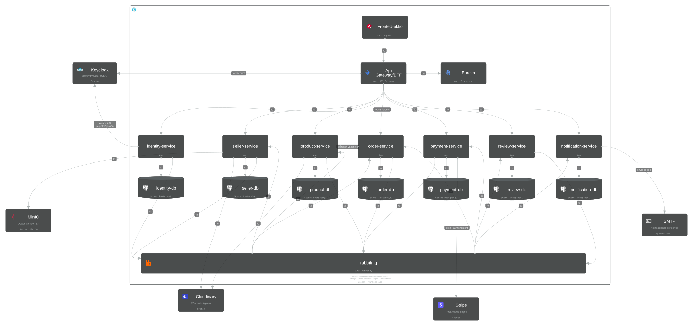

# Ekko

Ekko es una plataforma de e-commerce multi-vendedor que implementa el flujo completo de un marketplace: registro de usuarios, gestión independiente de vendedores y catálogos, control de inventario, checkout y procesamiento de pagos con liquidación individual mediante Stripe Connect.

Está construida con una arquitectura de microservicios basada en Java y Spring Boot. Los servicios se comunican de forma síncrona mediante REST y OpenFeign, y de forma asíncrona mediante eventos con RabbitMQ. Spring Cloud Gateway implementa el patrón BFF (Backend for Frontend) y centraliza el acceso a la plataforma.

## Arquitectura

El sistema está compuesto por microservicios independientes, con responsabilidades delimitadas y persistencia propia. La comunicación entre servicios combina llamadas REST y mensajería asíncrona.




- **Descubrimiento de servicios:** Netflix Eureka.
- **BFF y API Gateway:** Spring Cloud Gateway actúa como punto de entrada para el cliente, centralizando el enrutamiento, Token Relay, seguridad, resiliencia y control de solicitudes.
- **Resiliencia:** Resilience4j CircuitBreaker y endpoints de fallback
- **Rate limiting:** Redis
- **Autenticación y autorización:** Keycloak mediante OAuth2/OIDC, con autorización basada en roles.
- **Comunicación síncrona:** REST y OpenFeign.
- **Comunicación asíncrona:** RabbitMQ, con Dead Letter Queues (DLQ) y patrón Outbox en identity-service.
- **Pagos:** tripe Connect, mediante el modelo Separate Charges and Transfers.
- **Almacenamiento:** Cloudinary para imágenes y MinIO para documentos.
- **Persistencia:** PostgreSQL, con bases de datos independientes por servicio, UUID como clave primaria y enums nativos.

Las decisiones de arquitectura están documentadas mediante ADRs (Architecture Decision Records), que cubren, entre otros temas, microservicios, UUID, Saga por coreografía, Stripe Connect, RabbitMQ, Flyway, arquitectura hexagonal, Keycloak, comunicación entre servicios y Spring Cloud Gateway.

## Microservicios

| Servicio | Responsabilidad |
|---|---|
| `identity-service` | Registro de usuarios, gestión de credenciales, verificación de email y cambio de contraseña con step-up authentication. |
| `seller-service` | Gestión de perfiles y datos de negocio de vendedores |
| `product-service` | Catálogo de productos, inventario, categorías |
| `order-service` | Gestión y orquestación de pedidos mediante arquitectura hexagonal y Saga por coreografía. |
| `payment-service` | Procesamiento de pagos y liquidaciones mediante Stripe Connect. |
| `review-service` | Gestión de reseñas de productos. |
| `notification-service` | Notificaciones por correo electrónico e in-app, basadas en eventos. |
| `api-gateway` | BFF, punto de entrada único, enrutamiento, seguridad y resiliencia. |
| `eureka-server` | Registro y descubrimiento de servicios. |

## Stack tecnológico

**Backend**
- Java 21
- Spring Boot
- Spring Cloud Gateway
- Spring Cloud OpenFeign
- Spring Security (OAuth2)
- Spring Data JPA / Hibernate
- Spring Boot Actuator

**Datos y mensajería**
- PostgreSQL
- RabbitMQ
- Redis
- Flyway

**Identidad y seguridad**
- Keycloak
- OAuth2 / OpenID Connect
- JWT

**Infraestructura**
- Docker
- Docker Compose
- Kubernetes
- Minio

**Pagos y almacenamiento**
- Stripe Connect
- Cloudinary

**Pruebas y automatización**
- JUnit 5
- Mockito
- Pruebas unitarias e integración
- GitHub Actions

## Funcionalidades clave

**Identidad y seguridad**
- Registro diferenciado por rol (comprador, vendedor, administrador), con reglas de negocio propias para cada uno.
- Verificación de email y autenticación reforzada (step-up auth) obligatoria para operaciones sensibles como el cambio de contraseña.
- Bloqueo a nivel de Gateway de operaciones de escritura para usuarios sin email verificado.
- Comunicación interna entre servicios autenticada vía client credentials, sin depender de tokens de usuario.

**Catálogo e inventario**
- Gestión independiente de catálogos por vendedor.
- Administración de productos, variantes y categorías, con detección de ciclos.
- Control de inventario mediante bloqueo pesimista para reducir el riesgo de sobreventa ante operaciones concurrentes.

**Pedidos y pagos**
- Flujo de pedidos con reserva de inventario.
- Orquestación distribuida mediante Saga por coreografía.
- Procesamiento de pagos con Stripe Connect.
- Liquidaciones independientes para cada vendedor.
- Gestión explícita de estados de pago y protección de información sensible.

**Resiliencia y observabilidad**
- Circuit breakers y endpoints de fallback en el Gateway.
- Dead Letter Queues para mensajes que no pueden procesarse.
- Health checks mediante Spring Boot Actuator.
- Balanceo de carga mediante Eureka y Spring Cloud LoadBalancer en el Gateway.
- Rate limiting mediante Redis.

**Notificaciones y reseñas**
- Notificaciones por correo electrónico e in-app.
- Procesamiento de notificaciones basado en eventos de RabbitMQ.
- Plantillas configurables para los distintos tipos de notificación.
- Sistema de reseñas de productos.


## Despliegue
Ekko cuenta con dos alternativas de despliegue: Docker Compose y Kubernetes.

**Docker Compose**
Requisitos previos
- Docker Engine.
- Docker Compose.
- Variables de entorno configuradas para Keycloak, Stripe, Cloudinary, MinIO y SMTP.
  Para levantar el sistema:

```bash
docker-compose up --build
```

Docker Compose coordina el arranque de los servicios mediante dependencias y health checks basados en Spring Boot Actuator.

**Kubernetes**
El repositorio incluye manifiestos Kubernetes organizados por responsabilidad, para desplegar los microservicios y sus dependencias de infraestructura.

La configuración contempla:
- Namespace ekko.
- API Gateway y Eureka Server.
- Microservicios de identidad, vendedores, productos, pedidos, pagos, reseñas y notificaciones.
- PostgreSQL para los servicios y Keycloak.
- Keycloak, Redis, RabbitMQ y MinIO.
- Configuración de Ingress.
- ConfigMaps y Secrets para la configuración de los servicios.
  Los manifiestos están escritos en Kubernetes YAML nativo, sin Helm charts.

**Configuración y secretos**

Los archivos reales de configuración y secretos se mantienen fuera del control de versiones:
- ```k8s/config/```
- ```k8s/secrets/```
  
El repositorio incluye plantillas de referencia:
- ```k8s/config.example/```
- ```k8s/secrets.example/```
 
Antes del despliegue es necesario crear los archivos de configuración y secretos correspondientes, reemplazando los valores de ejemplo por los valores del entorno.


## Estructura del repositorio
Ekko está organizado como un monorepo: los microservicios, la infraestructura y los manifiestos de despliegue viven en un único repositorio.

```
ekko-marketplace/
├── api-gateway/
├── eureka-server/
├── identity-service/
├── seller-service/
├── product-service/
├── order-service/
├── payment-service/
├── review-service/
├── notification-service/
├── k8s/
│   ├── config.example/
│   ├── eureka/
│   ├── gateway/
│   ├── infrastructure/
│   │   ├── keycloak/
│   │   ├── minio/
│   │   ├── postgresql/
│   │   ├── rabbitmq/
│   │   └── redis/
│   ├── ingress/
│   ├── namespace/
│   ├── secrets.example/
│   ├── services/
│   ├── config/
│   └── secrets/
├── .github/
│   └── assets/
│       └── architecture.svg
├── docker-compose.yml
├── README.md
└── LICENSE
```
## Documentación adicional

Documentación técnica y decisiones de arquitectura (ADRs): [Documentación técnica](https://andersondiaz15.atlassian.net/wiki/external/MDhhMDAyMGJlZjNkNGU2NGJlM2U3ZTY4NmJiZGZkMTY)

Diagrama interactivo: [IcePanel](https://s.icepanel.io/ZthmG6qMlCbyqv/aQH9)

## Roadmap

- [x] Microservicios de dominio.
- [x] Comunicación síncrona y asíncrona.
- [x] API Gateway con patrón BFF como punto de entrada único.
- [x] Autenticación y autorización mediante Keycloak.
- [x] Procesamiento de pagos con Stripe Connect.
- [x] Resiliencia, balanceo de carga y rate limiting.
- [x] Infraestructura contenerizada con Docker Compose.
- [x] Manifiestos Kubernetes para los servicios y la infraestructura.
- [ ] Frontend.
- [ ] Observabilidad centralizada: logs, métricas y trazas.
- [ ] Despliegue en un entorno cloud.

## Licencia

Este proyecto está bajo la licencia MIT. Consulta el archivo [LICENSE](LICENSE) para más detalles.